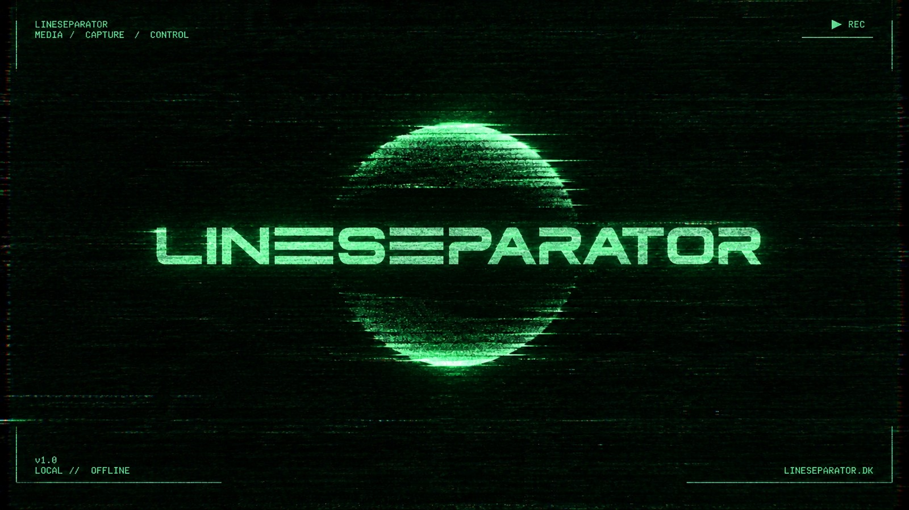
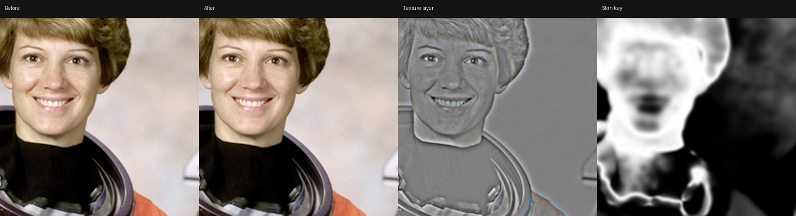

# LineSeparator Skin

Frekvensseparation til video som et OFX-plugin til DaVinci Resolve (og andre OFX-værter), inspireret af Greyscale Labs Serum.

Billedet deles i et **farvelag** (lave frekvenser: tone, rødme, pletter) og et **teksturlag** (høje frekvenser: porer, hår, fine detaljer). Farvelaget udglattes med et kantbevarende filter, teksturen bevares, og lagene lægges sammen igen. Resultatet er jævnere hud uden den plastik-agtige "blur"-look.



## Kontroller

**Frequency Separation**

| Kontrol | Hvad den gør |
| --- | --- |
| Separating Filter | Hvor grænsen mellem farve- og teksturlag går (pixels ved 1080p). Større værdi flytter mere detalje over i teksturlaget. |
| Color Layer Filter | Hvor meget farvelaget udjævnes. |
| Edge Protection | Holder stærke kanter (øjne, læber, kæbe) ude af udglatningen. |
| Color Layer Amount | Hvor meget af det udglattede farvelag der bruges. |
| Midtone Detail | Kontrast i mellemfrekvenserne lige under teksturen. Negativ værdi flader buler ud. |
| Texture | Forstærkning af teksturlaget (1 = uændret). |
| Blemish Reduction | Dæmper mørke pletter i teksturen, men lader porer og rigtige kanter være. |
| Post-Sharpen | Skærper de fineste detaljer efter sammensætningen. |
| Mix | Samlet styrke. |

**Masking**: Mask Source (hele billedet, Mask-input eller kildens alpha), Skin Key (blød hudtone-qualifier med hue, bredde og minimum mætning), Soften Mask og Invert Mask. I Resolve virker nodens egne windows og qualifier som normalt oveni.

**Color Management & View**: *Input Is* (gamma/log eller scene linear; ved linear sker separationen i et log-lignende rum) og *View* (Result, Color Layer, Texture Layer, Mask, Split Before/After).

Alle filterstørrelser er angivet ved 1080 linjer og skaleres med opløsningen, så et look ser ens ud i en 1080p-timeline og en 4K-render.

## Installation

Hent den seneste zip fra *Actions* (eller *Releases*), pak den ud og kopier `Seperator.ofx.bundle` til:

- **macOS:** `/Library/OFX/Plugins/`
- **Windows:** `C:\Program Files\Common Files\OFX\Plugins\`
- **Linux:** `/usr/OFX/Plugins/`

Genstart Resolve. Plugin'et ligger under *OpenFX → LineSeparator → LineSeparator Skin*.

På macOS er bundlen kun ad-hoc signeret. Hvis Resolve ikke vil indlæse den efter download:

```sh
sudo xattr -dr com.apple.quarantine /Library/OFX/Plugins/Seperator.ofx.bundle
```

## Byg selv

Kræver CMake 3.20+ og en C++17-compiler. OpenFX-headers og support-biblioteket hentes automatisk.

```sh
cmake -S . -B build -DCMAKE_BUILD_TYPE=Release
cmake --build build --parallel
ctest --test-dir build
```

Bundlen ender i `build/Seperator.ofx.bundle`. På macOS bygges den universal (arm64 + x86_64).

`sep_cli` kører den samme algoritme på et enkelt billede uden en OFX-vært:

```sh
python3 tools/pfm.py to-pfm portrait.jpg in.pfm
build/sep_cli in.pfm out.pfm colorSmooth=24 blemish=0.6 skinKey=1
python3 tools/pfm.py to-png out.pfm out.png
```

## Struktur

- `src/core/` – selve algoritmen, uafhængig af OFX (separation, guided filter, blemish-limiter, hud-key).
- `src/ofx/` – OFX-wrapper med parametre og clips.
- `tools/` – kommandolinjeværktøj og PFM-konvertering.
- `tests/` – tests af kernen på syntetiske billeder.

## Status og næste skridt

Version 0.1 kører på CPU (flertrådet). Omtrent 0,8 s pr. 4K-frame på 4 kerner; 1080p er ca. 4× hurtigere.

Næste skridt:

1. GPU-rendering (Metal på macOS, CUDA/OpenCL på Windows) for realtid.
2. Deflicker: tidslig udjævning af farvelaget på tværs af frames.
3. Automatisk ansigtstracking og personmaske (ML-model) i stedet for hue-baseret hud-key.
4. Relight: surface normals og virtuelle lyskilder, som i Serum v2.

Testbilledet i `docs/` er NASA-portrættet af Eileen Collins (public domain, fra scikit-image).
